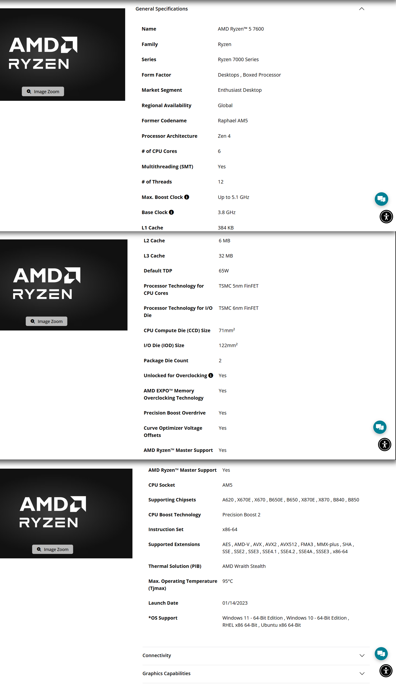
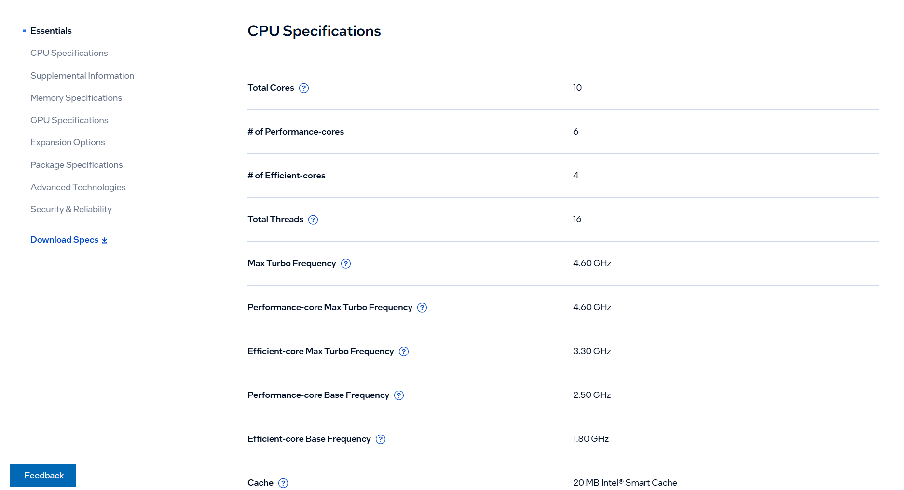
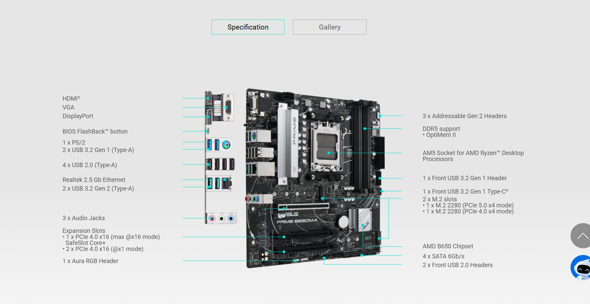
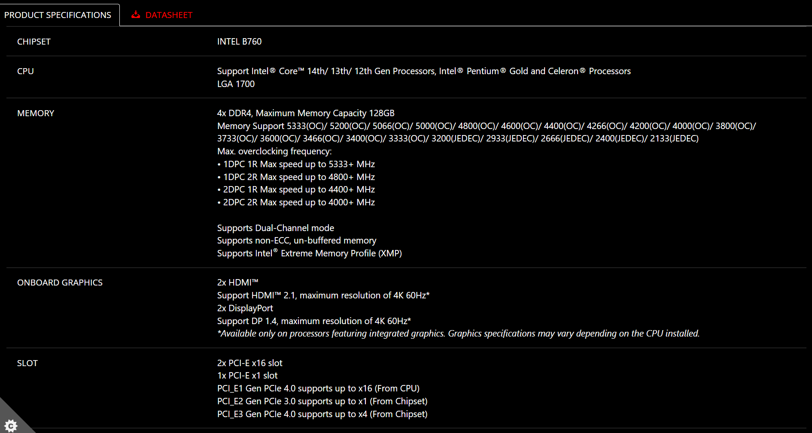
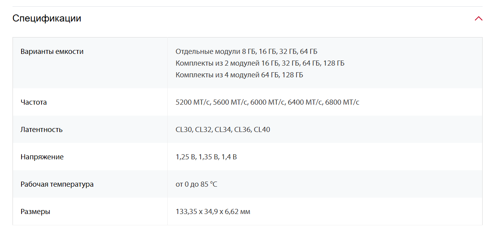
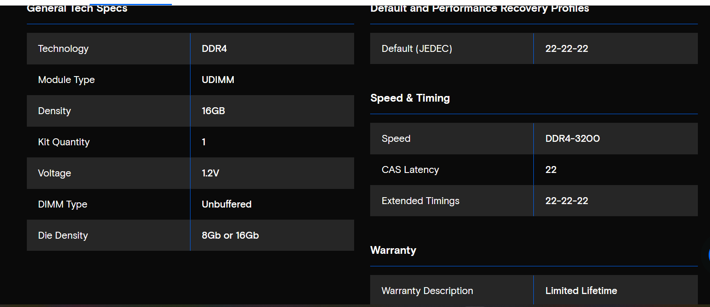
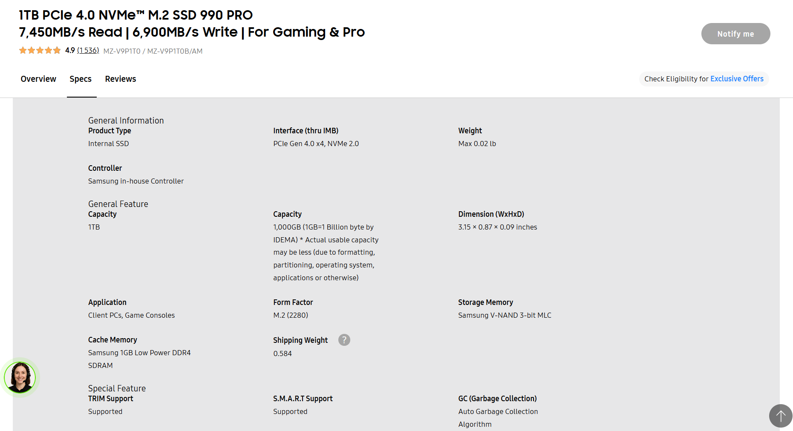
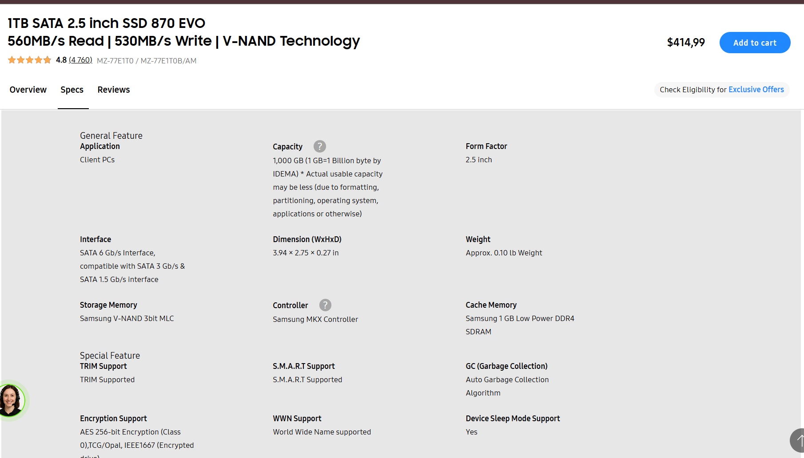
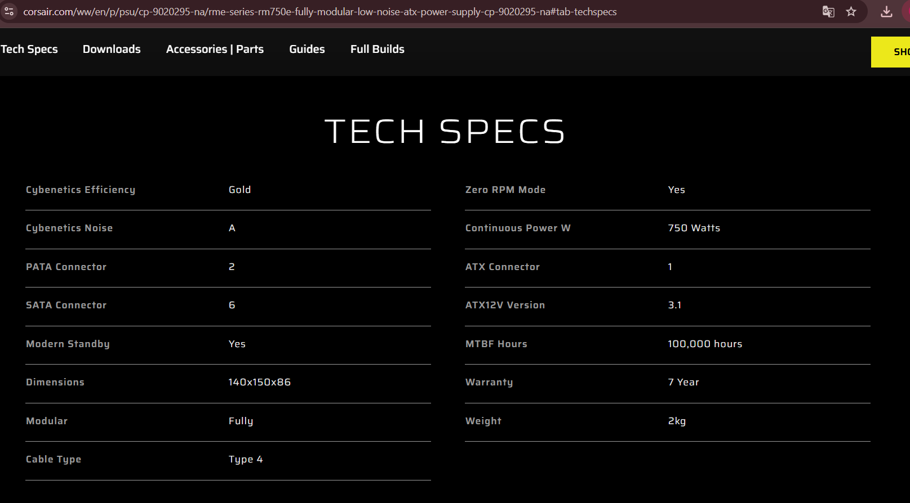

# Lab 3 - Teardown, and the same machine from the command line

Pair: Amina Marlenkyzy · Date: 08.11.2026

### AMD Ryzen 5 7600

Desktop processor (Zen 4), **6 cores / 12 threads**, 3.8 GHz base / up to 5.1 GHz boost, 6 MB L2 + 32 MB L3 cache, **65 W** default TDP, built-in AMD Radeon Graphics (2 cores). **Connects to:** socket **AM5** (B650, X670, A620 and other AM5 chipsets). Its memory controller takes **DDR5 only**, 2 channels, up to 128 GB. **Limit:** fits only AM5 boards and DDR5 memory. Official memory speed is DDR5-5200 (2 sticks), so faster memory runs at 5200 unless you turn on EXPO. Ships in the box with the **AMD Wraith Stealth** cooler.
— Source: https://www.amd.com/en/products/processors/desktops/ryzen/7000-series/amd-ryzen-5-7600.html

### Intel Core i5-13400

Desktop processor, **10 cores (6 P-cores + 4 E-cores) / 16 threads**, P-core base 2.5 GHz / up to 4.6 GHz turbo, 20 MB Intel Smart Cache, **65 W** base power (148 W max turbo), Intel UHD Graphics 730. **Connects to:** socket **FCLGA1700**. Its memory controller takes **DDR5-4800 or DDR4-3200**, 2 channels. **Limit:** fits only LGA1700 boards. It supports both DDR4 and DDR5, but each board has only one kind of slot, so the board decides. Intel's page lists no boxed cooler.
— Source: https://www.intel.com/content/www/us/en/products/sku/230495/intel-core-i513400-processor-20m-cache-up-to-4-60-ghz/specifications.html

### ASUS PRIME B650M-A

**Micro-ATX** motherboard (24.4 × 24.4 cm), **AMD B650** chipset. **Connects to:** socket **AM5**, **4 × DDR5** slots, **2 × M.2** (M.2_1 is PCIe 5.0 x4 with Ryzen 7000, M.2_2 is PCIe 4.0 x4), **4 × SATA 6 Gb/s**, one 8-pin CPU power connector. **Limit:** takes only AMD Ryzen 7000 / 8000 / 9000 processors (AM5) and **only DDR5** memory.
— Source: https://www.asus.com/motherboards-components/motherboards/prime/prime-b650m-a/

### MSI PRO B760M-A WIFI DDR4

**Micro-ATX** motherboard (24.4 × 24.4 cm), **Intel B760** chipset, Wi-Fi 6E + Bluetooth 5.3. **Connects to:** socket **LGA1700**, **4 × DDR4** slots (up to 128 GB), **2 × M.2** (both PCIe 4.0 x4; M.2_2 also takes SATA M.2), **4 × SATA 6 Gb/s**, two CPU power connectors. **Limit:** takes only Intel 12th / 13th / 14th-gen processors and **only DDR4** memory.
— Source: https://www.msi.com/Motherboard/PRO-B760M-A-WIFI-DDR4/Specification

### Kingston FURY Beast DDR5-5600, 16 GB

**DDR5** desktop DIMM, **16 GB**, **5600 MT/s**, 1.25 V, with Intel XMP 3.0 / AMD EXPO profiles and on-die ECC. **Connects to:** a DDR5 DIMM slot on a desktop board. **Limit:** works only in DDR5 boards. The notch is in a different place from DDR4, so it physically won't go into a DDR4 slot. It reaches 5600 only if the board and CPU allow it (EXPO/XMP).
— Source: https://www.kingston.com/en/memory/gaming/kingston-fury-beast-ddr5-memory

### Crucial DDR4-3200, 16 GB DIMM (CT16G4DFRA32A)

**DDR4** desktop module, **UDIMM** (unbuffered), **16 GB**, **DDR4-3200**, 1.2 V, CL22 (22-22-22). **Connects to:** a DDR4 DIMM slot on a desktop board. **Limit:** works only in DDR4 boards. The notch makes a DDR5 slot impossible, and it's a desktop module, so it won't fit a laptop SO-DIMM slot.
— Source: https://www.crucial.com/memory/ddr4/ct16g4dfra32a

### Samsung 990 PRO 1 TB

SSD, **1 TB** (MZ-V9P1T0B), **NVMe PCIe 4.0**, **M.2 2280**, up to **7,450 MB/s** read / 6,900 MB/s write. **Connects to:** an M.2 (M-key) slot on the board. It needs no cables. **Limit:** needs a free M.2 NVMe slot. In a PCIe 3.0 slot it would run at about half its speed.
— Source: https://www.samsung.com/us/memory-storage/nvme-ssd/990-pro-pcie-4-0-nvme-ssd-2tb-sku-mz-v9p1t0b-am/

### Samsung 870 EVO 1 TB

SSD, **1 TB** (MZ-77E1T0BW), **SATA 6 Gb/s**, **2.5″** form factor, up to **560 MB/s** read / 530 MB/s write, 600 TBW, 5-year warranty. **Connects to:** a SATA port on the board using a **SATA data cable**, plus a **SATA power cable** from the PSU. **Limit:** the SATA bus tops out at about 550–600 MB/s, so it's around 13× slower than the 990 PRO.
— Source: https://www.samsung.com/kz_ru/memory-storage/sata-ssd/870-evo-1tb-sata-3-2-5-ssd-mz-77e1t0bw/

### Corsair RM750e (750 W)

ATX power supply, **750 W**, **Cybenetics Gold** efficiency, **ATX 3.1**, **fully modular**, 120 mm fan. **Connects to:** the board (1 × 24-pin ATX, 2 × 8-pin CPU EPS), drives (6 × SATA power), and a graphics card (12V-2x6 + PCIe 8-pin). **Limit:** 750 W in total. That's plenty for either build, but there is **only one PSU** for two computers.
— Source: https://www.corsair.com/ww/en/p/psu/cp-9020295-na/rme-series-rm750e-fully-modular-low-noise-atx-power-supply-cp-9020295-na

### Stock cooler — AMD Wraith Stealth

Small air cooler that ships **in the box with the Ryzen 5 7600** (AMD lists it as "Thermal Solution (PIB): AMD Wraith Stealth"). **Connects to:** socket **AM5** (AM4/AM5 mounting). **Limit:** made for ~65 W processors. It won't mount on Intel LGA1700. The i5-13400 page lists no cooler, so this is the only stock cooler in the list.
— Source: https://www.amd.com/en/products/processors/desktops/ryzen/7000-series/amd-ryzen-5-7600.html

### The two motherboards compared

| | ASUS PRIME B650M-A | MSI PRO B760M-A WIFI DDR4 |
|---|---|---|
| Socket | AM5 | LGA1700 |
| Chipset | AMD B650 | Intel B760 |
| Form factor | micro-ATX | micro-ATX |
| Memory type / slots | DDR5, 4 slots | DDR4, 4 slots (max 128 GB) |
| M.2 slots | 2 (PCIe 5.0 x4 + PCIe 4.0 x4) | 2 (PCIe 4.0 x4 + PCIe 4.0 x4/SATA) |
| SATA ports | 4 × SATA 6 Gb/s | 4 × SATA 6 Gb/s |
| Processors accepted | AMD Ryzen 7000 / 8000 / 9000 | Intel Core 12th / 13th / 14th gen |
| BIOS update needed? | <check the CPU Support list> | <check the CPU Support list> |

## Two builds

### Build 1 — AMD
| Part | Model | Why it fits here |
|---|---|---|
| Processor | AMD Ryzen 5 7600 | Needs socket AM5, and this board has AM5. |
| Motherboard | ASUS PRIME B650M-A | AM5 socket and B650 chipset, both of which AMD lists for the 7600. Takes DDR5, which is the only memory the 7600 supports. |
| Memory | Kingston FURY Beast DDR5-5600 16 GB | DDR5, the only memory type both the board and the CPU take. |
| SSD | Samsung 990 PRO 1 TB | M.2 NVMe PCIe 4.0 goes into the board's M.2 slot. No cables needed. |
| Power supply | Corsair RM750e | Its 24-pin and 8-pin CPU cables match the board. 750 W is far more than a 65 W CPU build needs. |
| Cooler | AMD Wraith Stealth | Ships with the 7600 and mounts on AM5. |

### Build 2 — Intel
| Part | Model | Why it fits here |
|---|---|---|
| Processor | Intel Core i5-13400 | Needs socket LGA1700, and this board has LGA1700. |
| Motherboard | MSI PRO B760M-A WIFI DDR4 | LGA1700 socket and 12th–14th-gen support, which covers the 13th-gen i5. |
| Memory | Crucial DDR4-3200 16 GB UDIMM | The board takes only DDR4, and the i5-13400 supports DDR4-3200. |
| SSD | Samsung 870 EVO 1 TB | 2.5″ SATA goes into one of the board's 4 SATA ports. |
| Power supply | **missing** | There's only one PSU in the list, and it's in Build 1. |
| Cooler | **missing** | The only stock cooler is AMD's, and it doesn't fit LGA1700. |

What each build still needs to switch on:
- **Both:** a **case** (micro-ATX or bigger). A graphics card is **not** needed, because both processors have built-in graphics and both boards have video outputs. For use, each also needs a monitor, keyboard and mouse.
- **Build 2 also needs:**
  - a **power supply** with a 24-pin and an 8-pin CPU cable
  - an **LGA1700 cooler**
  - a **SATA data cable** for the 870 EVO (if the board's box has none)
- *Optional:* a second stick of memory for each build, to get dual channel.

## Part 2 — Same facts, three operating systems
<the table>
<2–3 sentences: how the names differ; what the VM showed>

## What did not work the first time
We first used the Crucial page for **CT16G4SFRA32A**. Its spec table said **Module Type: SODIMM**: a 260-pin laptop module that would not fit the MSI desktop board. The lab asks for a DIMM, so we switched to **CT16G4DFRA32A**, whose page says **Module Type: UDIMM**: the 288-pin desktop module that fits the board's DDR4 slots. The only difference in the part number is **SF** (SO-DIMM) versus **DF** (desktop).

## Evidence
- evidence/photos/ — product photos or screenshots from each maker's page
- evidence/windows-specs.txt — <command(s) used on the Vivobook host>
- evidence/linux-specs.txt — <command(s) used in the Ubuntu VM>