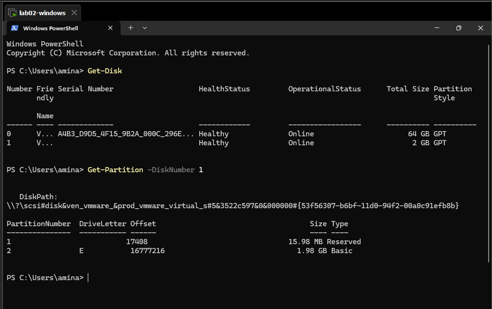

# Lab 4 - Partition, mirror, fail, recover

Student: Amina Marlenkyzy · Date: 15.11.2026 · Lab 4

**Environment:** VMware Workstation Pro · `lab01-ubuntu` (Ubuntu Server, `mdadm`) · `lab02-windows` (Windows 11)
**Evidence** was written straight into this folder from the Ubuntu VM through a VMware Shared Folder (`/mnt/hgfs/labs/lab04-storage`), so every file was captured at the moment its state existed.

### Acceptance checklist

| Criterion | Where |
|---|---|
| Windows partition + MBR/GPT and why | [Section 1](#1-windows---partition-format-letter-step-23) |
| Layout before and after | [Section 2](#2-linux-layout---before) and [Section 5](#5-linux-layout---after) |
| Three array states evidenced separately | [Section 4 - Timeline](#timeline---three-separate-states) |
| Checksums match before and after the failure | [Section 4 - Checksums](#checksums---before-vs-after-failure) |
| RAID 1 vs backup question | [Section 7](#7-your-colleague-deleted-the-wrong-file-from-the-mirror-an-hour-ago-does-raid-1-help-why) |

---

## 1. Windows - partition, format, letter (step 23)

- Added a new **2 GB SCSI** virtual disk to the Windows VM.
- Disk Management → *Initialize Disk* → **GPT** → *New Simple Volume* → **NTFS**, default allocation unit, quick format, drive letter **E:**.
- Checked with PowerShell `Get-Disk` and `Get-Partition -DiskNumber 1`:

| Item | Value |
|---|---|
| Disk 1 | 2 GB, Healthy, Online, **Partition Style: GPT** |
| Partition 1 | 15.98 MB, *Reserved* - the **MSR** (Microsoft Reserved Partition), created automatically by Windows on every GPT disk |
| Partition 2 | 1.98 GB, *Basic*, drive letter **E:** |
| Disk 0 (system) | 64 GB, also **GPT** → this VM boots with **UEFI** |



**MBR or GPT, and why:**

> I chose GPT because MBR has no backup of its partition table, while GPT keeps a second copy at the end of the disk plus a CRC checksum, so corruption can be detected and repaired. It is also UEFI's native format, and this VM already boots with UEFI (its system disk is GPT too), so GPT keeps both disks consistent.

---

## 2. Linux layout - before

Three new, empty 2 GB disks (`sdb`, `sdc`, `sdd`) attached to the Ubuntu guest: no partitions, no mountpoints. `sda` is the system disk and was never touched.

```
NAME                      MAJ:MIN RM  SIZE RO TYPE MOUNTPOINTS
loop0                       7:0    0 66.8M  1 loop /snap/core24/1643
loop1                       7:1    0  1.5M  1 loop /snap/hwctl/123
loop2                       7:2    0  1.5M  1 loop /snap/hwctl/131
loop3                       7:3    0 50.1M  1 loop /snap/snapd/27710
sda                         8:0    0   25G  0 disk
├─sda1                      8:1    0    1M  0 part
├─sda2                      8:2    0    2G  0 part /boot
└─sda3                      8:3    0   23G  0 part
  └─ubuntu--vg-ubuntu--lv 252:0    0 11.5G  0 lvm  /
sdb                         8:16   0    2G  0 disk
sdc                         8:32   0    2G  0 disk
sdd                         8:48   0    2G  0 disk
sr0                        11:0    1  2.7G  0 rom
```

---

## 3. What I did (steps 24–27)

| Step | Action | Command(s) |
|---|---|---|
| 24 | GPT label + one partition flagged **Linux RAID** on `sdb` and `sdc` (`sdd` kept as the spare) | `parted /dev/sdX --script mklabel gpt mkpart primary 0% 100% set 1 raid on` |
| 24 | Built a **RAID 1** mirror with a write-intent bitmap | `mdadm --create /dev/md0 --level=1 --raid-devices=2 /dev/sdb1 /dev/sdc1` |
| 24 | Waited for the initial resync (`[UU]`), then formatted and mounted the **array**, not the member disks | `mkfs.ext4 /dev/md0` · `mount /dev/md0 /mnt/mirror` |
| 25 | Wrote a recognisable text file and a 10 MB random file, recorded their SHA-256 | `echo ... \| tee proof.txt` · `dd if=/dev/urandom of=random.bin bs=1M count=10` · `sha256sum` |
| 26 | Failed and removed `sdc1` → `[U_]`; unmounted and remounted so the files were really read from the surviving disk (not from RAM cache); re-checked SHA-256 and compared | `mdadm --fail` · `mdadm --remove` · `umount` / `mount` · `sha256sum` · `diff` |
| 27 | Partitioned `sdd` the same way, added it, watched the recovery until `[UU]` | `mdadm /dev/md0 --add /dev/sdd1` · `cat /proc/mdstat` |

---

## 4. Evidence

| File | What it shows |
|---|---|
| [`lsblk-before.txt`](evidence/lsblk-before.txt) | Three empty disks, no partitions, no mountpoints |
| [`lsblk-partitioned.txt`](evidence/lsblk-partitioned.txt) | *(extra)* `sdb1` and `sdc1` created, `sdd` still empty |
| [`array-healthy.txt`](evidence/array-healthy.txt) | `State : clean` · 2 / 2 devices · `sdb1` + `sdc1` **active sync** · `Intent Bitmap : Internal` · Events 18 |
| [`checksum-before.txt`](evidence/checksum-before.txt) | SHA-256 of `proof.txt` and `random.bin` on the healthy mirror |
| [`array-degraded.txt`](evidence/array-degraded.txt) | `State : clean, degraded` · Total / Active / Working Devices **1** · slot 1 **removed** · Events 21 |
| [`checksum-after-failure.txt`](evidence/checksum-after-failure.txt) | SHA-256 after the failure - **identical** to before |
| [`array-rebuilt.txt`](evidence/array-rebuilt.txt) | `State : clean` · 2 / 2 devices · `sdb1` + **`sdd1`** active sync · `sdc1` gone · Events 47 |
| [`lsblk-after.txt`](evidence/lsblk-after.txt) | *(extra)* final layout |
| [`windows-disk.png`](evidence/windows-disk.png) | Windows GPT disk with partition E: |

### Checksums - before vs after failure

| File | Before failure | After failure |
|---|---|---|
| `proof.txt` | `c2ee2d7d…7928af98` | `c2ee2d7d…7928af98` ✅ |
| `random.bin` (10 MB) | `400dc745…874dd8ce` | `400dc745…874dd8ce` ✅ |

`diff checksum-before.txt checksum-after-failure.txt` printed nothing → the files are bit-for-bit identical.

### Timeline - three separate states

Taken from the `Update Time` and `Events` lines inside each `mdadm --detail` file. Each state was captured at a different moment, not in one screenshot at the end.

| State | `Update Time` | `Events` | `State` | Members |
|---|---|---|---|---|
| Healthy | 11:37:02 | 18 | `clean` | `sdb1` + `sdc1` |
| Degraded | 12:32:40 | 21 | `clean, degraded` | `sdb1` only |
| Rebuilt | 12:44:42 | 47 | `clean` | `sdb1` + `sdd1` |

The `Events` counter only grows. It goes up every time the array changes (fail, remove, add, recovery), which confirms the order of the three captures.
**Result:** one member disk was lost, the filesystem stayed readable, and the data survived - **proven** by matching SHA-256 hashes, not just asserted.

> Usable capacity is **2044 MiB**, not 4 GB: RAID 1 gives up half of the raw space in exchange for redundancy.

---

## 5. Linux layout - after

```
NAME                      MAJ:MIN RM  SIZE RO TYPE  MOUNTPOINTS
loop0                       7:0    0 66.8M  1 loop  /snap/core24/1643
loop1                       7:1    0  1.5M  1 loop  /snap/hwctl/123
loop2                       7:2    0  1.5M  1 loop  /snap/hwctl/131
loop3                       7:3    0 50.1M  1 loop  /snap/snapd/27710
sda                         8:0    0   25G  0 disk
├─sda1                      8:1    0    1M  0 part
├─sda2                      8:2    0    2G  0 part  /boot
└─sda3                      8:3    0   23G  0 part
  └─ubuntu--vg-ubuntu--lv 252:0    0 11.5G  0 lvm   /
sdb                         8:16   0    2G  0 disk
└─sdb1                      8:17   0    2G  0 part
  └─md0                     9:0    0    2G  0 raid1 /mnt/mirror
sdc                         8:32   0    2G  0 disk
└─sdc1                      8:33   0    2G  0 part
sdd                         8:48   0    2G  0 disk
└─sdd1                      8:49   0    2G  0 part
  └─md0                     9:0    0    2G  0 raid1 /mnt/mirror
sr0                        11:0    1  2.7G  0 rom
```

**Before → after:** `md0` (RAID 1, mounted at `/mnt/mirror`) now sits on **`sdb1` + `sdd1`**. `sdc` still has its partition, but it is no longer a member of the array (it was the "failed" disk).

## 6. What did not work (and how I fixed it)

1) `lsblk > evidence/lsblk-before.txt` → `No such file or directory` The `evidence` folder didn't exist inside the VM. `>` can create a file but not a missing folder. My lab folder lives on the Windows host, not in Ubuntu. Shared the host folder with the VM (VMware → Options → Shared Folders) and worked from `/mnt/hgfs/labs/lab04-storage`, so the evidence lands straight in this repo.
2) `ls mnt/hgfs` → `cannot access 'mnt/hgfs'` Relative path: without the leading `/` Linux looked for `~/mnt/hgfs`. Used the absolute path `/mnt/hgfs`.
3) The first `lsblk` showed only `sda` - no extra disks. The three extra virtual disks had not been attached to the Ubuntu VM yet. Powered off, added 3 × 2 GB SCSI disks in VMware, booted again and re-captured `lsblk-before.txt`.
4) `mdadm --create` → `cannot open /dev/sdc1: No such file or directory` `sdc` had not been partitioned (or the kernel hadn't re-read its table), so `sdc1` didn't exist. mdadm creates nothing if any member is missing. Re-ran `parted` on `sdc`, then `partprobe /dev/sdc`, checked `lsblk`, and ran `mdadm --create` again → `array /dev/md0 started`.
5) `Ctrl+C` didn't seem to stop `watch cat /proc/mdstat`, then the screen went blank. VMware keyboard focus - the keys only reach the guest when the VM window has focus. `watch` clears the screen when it exits, so blank = it had actually stopped. Clicked into the VM, pressed Enter to get the prompt back, and afterwards just repeated `cat /proc/mdstat` (↑ + Enter) instead of `watch`.

**Prompts I answered along the way**

- *"Enable write-intent bitmap?"* → **yes**. The bitmap records which regions are being written, so after a crash or re-adding the same disk only the "dirty" regions are resynced instead of the whole disk. (A brand-new disk like `sdd1` still gets a full rebuild.)
- *"This array has metadata at the start and may not be suitable as a boot device"* → **continue**. It only matters if `/boot` were on the array; this is a data disk and Ubuntu boots from `sda`.

## 7. Your colleague deleted the wrong file from the mirror an hour ago. Does RAID 1 help? Why?

No, RAID 1 doesn't help in this case. It mirrors every action to both disks, including accidental file deletions, so the file disappeared from both copies at the same moment. Only a backup or a snapshot would help, because it keeps an older copy of the file from before the deletion, which can be restored.
