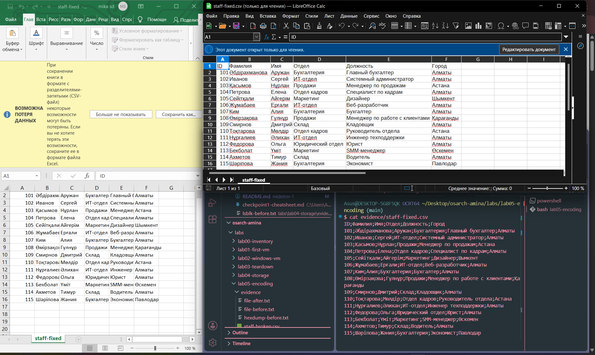

# Lab 5 — Encoding forensics

Name: Amina · Date: 18.11.2026 · Tools: Git Bash, Excel, LibreOffice, Windwos host

## What I received
Excel: Columns were split correctly but the text was a little pressed aginst each other, the main thing is that the russian names were readable but kazakh ones not. For example: Ќасымов lost the specific kazakh letter at the start of his name.
LibreOffice: Same as Excel, plus the important note: the Character set default was "Автоматически", and it guessed Windows-1251. It also detected the separator as ; (semicolon).
Terminal (cat in Git Bash): Instead of the normal kazakh or russian letters there were □ boxes: Git Bash expects UTF-8, where every Cyrillic letter is two bytes. The file gives it bytes it can’t read as UTF-8, so it shows □ (the replacement character). ID, the numbers and ; look fine, these are plain ASCII (english letters, digits, punctuation), and ASCII bytes are the same in almost every encoding. Only the non-English letters break.

## Diagnosis (made before the fix)
- file said: Non-ISO extended-ASCII text, with CRLF line terminators (evidence/file-before.txt)
- First 16 bytes: 49 44 3b d4 e0 ec e8 eb e8 ff 3b c8 ec ff 3b ce (evidence/hexdump-before.txt)
- Encoding: KZ-1048 (RK1048) — because each letter is one byte; Russian letters match Windows-1251 (Ф = D4, а = E0), but the Kazakh letter Ә is the single byte A3, which is Ә in KZ-1048 and Ј in Windows-1251. `iconv -f RK1048` shows every name correctly; `iconv -f WINDOWS-1251` gives Јбдірахманова, Ќасымов.
- Line ending: CRLF — because line 1 ends with 0D 0A (offset 0x24)
- BOM: no — because the file starts with 49 44 ("ID"), not EF BB BF / FF FE / FE FF
- Separator: ;

## Fix
`scripts/fix.sh`, run from `labs/lab05-encoding/` with `sh scripts/fix.sh`:

```sh
iconv -f RK1048 -t UTF-8 evidence/staff-broken.csv > evidence/staff-fixed.csv
printf '\357\273\277' | cat - evidence/staff-fixed.csv > tmp && mv tmp evidence/staff-fixed.csv
```


## Verification
- `file` now says: Unicode text, UTF-8 (with BOM) text, with CRLF line terminators (evidence/file-after.txt)
- The hex starts with `EF BB BF` (BOM), then `49 44 3B` (`ID;`); Cyrillic letters are now two bytes (Ф = `D0 A4`, before it was the single byte `D4`).
- Excel (double-click), LibreOffice Calc (UTF-8, `;`) and `cat` in Git Bash all show every name correctly, including Kazakh letters (Ә, Қ, Ұ, Ө):



## What did not work the first time
When copying and pasting from the terminal into Git Bash it added `[200~` before `cd`, so `cd` failed and the next command couldn't find `evidence/`. I typed everything by hand instead, copying always created the `[200~` thing. Not only there, but copying from the GitBash always puts some junk at the beginning and it creates confusion.